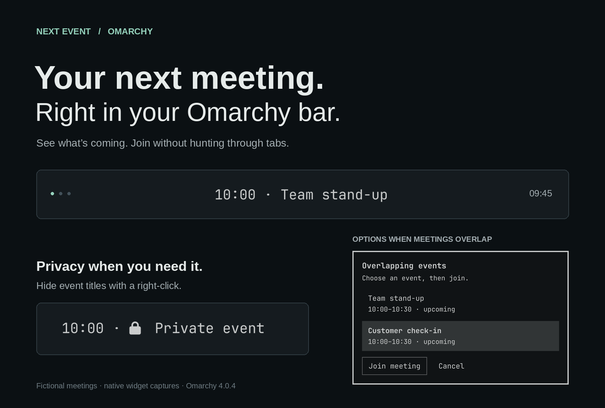
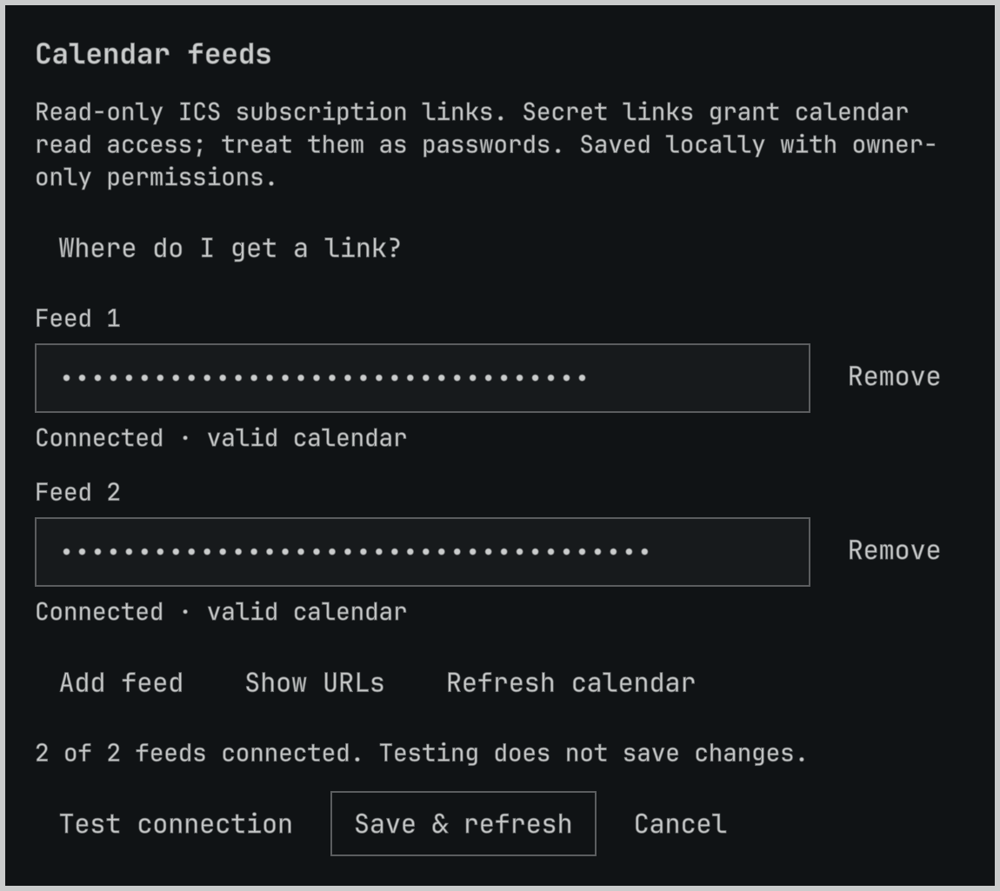
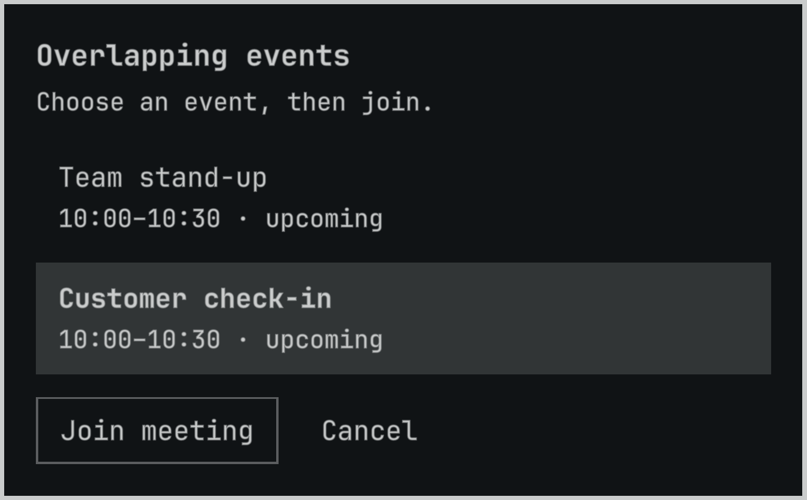

# Next Event

**Your next meeting. Right in your Omarchy bar.**

A lightweight meeting companion—not another full calendar. See what’s coming,
get a timely heads-up, and join without hunting through tabs.

Your calendar handles the planning. Next Event keeps what’s next within reach.



- **Small and focused.** No month views or event management—just upcoming meetings.
- **Less tab-hopping.** Join Google Meet, Teams, or Zoom straight from the bar.
- **A timely heads-up.** Reminders before meetings and when they start.
- **Privacy when you need it.** Hide event titles with a right-click.
- **Your calendars, together.** Upcoming meetings from multiple calendars in one place.

Demo images use fictional meetings; no private calendar data is shown.

## Get started

Requires **Omarchy Quattro** with its built-in bar and system Python **3.10+**.
Calendar libraries are included: no additional Python packages, build step,
or runtime installer. Add the widget:

```sh
omarchy plugin add https://github.com/barlevalon/omarchy-next-event.git --enable
```

Choose a bar section when prompted. Then:

1. Left-click **setup**, or middle-click the widget, to open calendar settings.
2. Paste an **HTTPS ICS subscription link** from your calendar provider.
3. Select **Test connection**, then **Save & refresh**.

Use **Add feed** to connect additional calendars. Settings also include provider
help and a refresh button. An empty calendar still leaves settings within reach.

<details>
<summary>See calendar settings with fictional feeds</summary>



</details>

**Treat subscription links as passwords.** Anyone holding a secret calendar
link may be able to read the calendar. Follow your organization’s sharing policy.

<details>
<summary>Find your calendar’s subscription link</summary>

**Google Calendar, on the web:** Settings, select your calendar, Integrate
calendar, then copy **Secret address in iCal format**.
[Google’s instructions](https://support.google.com/calendar/answer/37648).

**Outlook, on the web:** Settings, Calendar, Shared calendars, Publish a
calendar. Choose the calendar and permissions, then copy the **ICS** link,
not the HTML link. Publishing exposes the selected details to anyone with
that link. [Microsoft’s instructions](https://support.microsoft.com/en-us/outlook/share-your-calendar-in-outlook-com).

Workplace administrators may disable these options. Do not make a work calendar
public or bypass an organization’s policy to use this widget.

</details>

## Everyday use

| Action | Result |
| --- | --- |
| Left-click a meeting with a recognized link | Join the meeting |
| Middle-click | Open calendar settings |
| Right-click | Toggle privacy mode |
| Left-click setup, an error, or the empty calendar icon | Open calendar settings |

Privacy mode hides event titles in the bar, tooltips, picker, and reminders.
It starts enabled; a right-click makes switching quick when sharing your screen.
Times and overlap counts remain visible. Privacy mode protects the display,
not access to the calendar or an explicitly opened meeting link.

### When meetings overlap

An overlap badge gives a heads-up without rotating or hiding your next meeting.
Click it to see the choices, select a meeting, then choose **Join meeting**.
Nothing opens until you choose to join. Back-to-back and zero-duration entries
do not create overlaps.

<details>
<summary>See the meeting picker</summary>



</details>

Meetings without a recognized Google Meet, Teams, or Zoom link remain visible,
but cannot be joined from the picker.

## Update or remove

Update:

```sh
omarchy plugin update io.github.barlevalon.next-event
omarchy restart shell
```

Remove:

```sh
omarchy plugin remove io.github.barlevalon.next-event
```

Removal asks for confirmation and leaves your calendar-feed configuration in
place. To clear stored links, remove every feed and save **before** uninstalling.
Revoking or resetting the sharing link at your provider is a separate action.

The permanent plugin ID is `io.github.barlevalon.next-event`; default placement
is the center. If you installed the early `alon.next-event` version, migrate
**before** an ordinary update: updates do not rename an installed folder.
Back up the old plugin folder and `shell.json`, and record placement and privacy
settings. Then:

```sh
omarchy plugin remove alon.next-event
omarchy plugin add https://github.com/barlevalon/omarchy-next-event.git --enable
omarchy restart shell
```

Restore your recorded placement and privacy choice after adding. Feed links
remain in the external configuration file; removal does not delete them.

## Details and limits

<details>
<summary>Calendar behavior</summary>

- Active and upcoming timed events today are shown in the system’s local timezone.
  All-day and cancelled events are skipped; recurring events are expanded.
- Calendars refresh every five minutes. Start/end display changes can lag;
  reminders have a separate scheduler between refreshes.
- One widget instance owns background fetching and reminders across monitors;
  peer widgets share results. Ownership moves when that instance disappears.
- Reminder history lasts for the active widget group, not across shell restarts
  or complete plugin reloads.
- Overlaps are direct intersections with the meeting shown in the bar.
- Up to 32 HTTPS feeds are accepted, at most 10 MiB per response, with a
  ten-second socket timeout per request. Requests run sequentially; the timeout
  is not a total wall-clock deadline. Large calendars or recurrence expansion
  can still consume substantial resources. Configure only trusted subscriptions.

</details>

<details>
<summary>Privacy and storage</summary>

Next Event reads calendar feeds. It does not create, edit, or delete events,
use OAuth, or send calendar data to an additional service. Like other Omarchy
plugins, it runs unsandboxed with the current user’s privileges.

Feed links are masked in settings and when settings reopens. Testing does not
save changes; **Cancel** discards edits. Failed reads cannot overwrite unread
settings—use **Retry load**.

Configuration is saved atomically with owner-only permissions (`0600`) to:

```text
${XDG_CONFIG_HOME:-~/.config}/omarchy/calendar-feeds
```

This is plaintext storage, not encryption. URLs travel to the helper over stdin,
not command-line arguments. Connection errors do not display URLs or private
calendar text. While privacy mode is enabled, reminders have no meeting action;
an explicit click on the bar can still open the recognized meeting link.

Never include real feed links or private event data in issues, screenshots, or
Git repositories. Reset a provider’s secret link if it has been exposed.

</details>

<details>
<summary>Compatibility and dependencies</summary>

Native UI tested on **Omarchy 4.0.4 / Qt 6.11**. The bundled helper requires
Python **3.10+**, with pinned `icalendar` 7.3.0 and `recurring-ical-events` 3.8.2.
This is not a standalone Waybar widget.
Palette references are qualified for Qt 6.12’s `Color` name change; native
Qt 6.12 validation remains a separate check.

The helper uses `/usr/bin/python3` and imports calendar libraries from the
plugin’s `vendor/` directory, not installed calendar packages. Transitive
Python libraries are included. Python’s standard `zoneinfo` reads Arch’s existing
timezone database (`tzdata`, already required by `glibc`); a second database is
not bundled. Nothing is downloaded or installed at runtime; maintainers update
the pinned bundle explicitly.
See [bundled components and licenses](THIRD_PARTY.md).
Node.js is needed only for development tests. “Lightweight” describes a focused
experience, not a benchmarked CPU or memory footprint.

The feed editor uses the eager-content `Ui.KeyboardPanel` API shipped in the
tested runtime. Newer shells’ lazy-content API needs separate native acceptance
testing before claiming support. No plugin installer runs automatically, and
no sudo or pkexec is used at runtime.

</details>

## Development checks

With Python and Node.js installed (`-S` excludes user/system site-packages):

```sh
/usr/bin/python3 -S test_bundle.py
/usr/bin/python3 -S next_event.py --self-test
/usr/bin/python3 -S test_feed_config.py
node privacy_test.cjs
node feed_settings_test.cjs
node coordination_test.cjs
qmllint BarWidget.qml FeedSettings.qml
omarchy plugin validate .
```

Tests use synthetic data and temporary configurations, never real calendar
feeds. Keep development virtual environments outside the plugin checkout:
Omarchy validation rejects symlinks inside plugin folders. CI runs the Python
and JavaScript checks in a fresh Arch Linux container. Native dialogs, focus,
geometry, and monitor lifecycle also need an Omarchy Wayland session.

## License

Original plugin code: [MIT](LICENSE). Bundled components retain their own
licenses, including LGPL-3.0-or-later; see [THIRD_PARTY.md](THIRD_PARTY.md).
